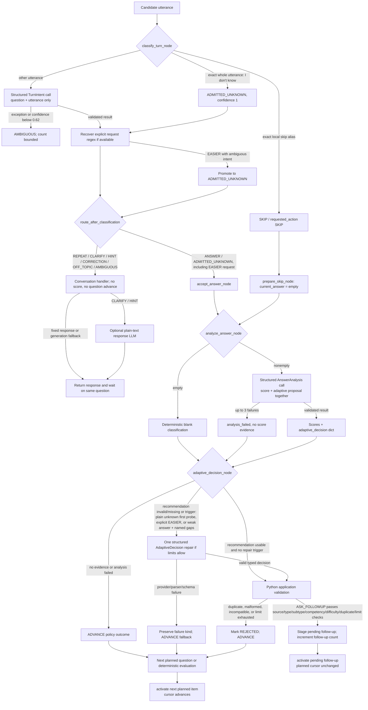

# InterviewOS LLM call flow and data lineage

This document describes the application-level execution visible in the current source. It distinguishes model/API calls from Python policy, persistence, and audio-device work. References use repository-relative paths and line ranges verified against the inspected working tree. Provider transport details below the LangChain client boundary are not established by this repository.

## Runtime configuration and scope

- LLM clients are `langchain_groq.ChatGroq`, configured with the `GROQ_API_KEY` loaded by `app/config.py`. The model identifier is hard-coded as `openai/gpt-oss-120b`; it is not dynamically selected. Resume analysis uses temperature `0.1`; the shared planner/engine clients use `0.2`. No token limit is set at these call sites. See [app/config.py](../../app/config.py#L1-L26), [app/services/resume_service.py](../../app/services/resume_service.py#L19-L26), [app/services/planner_service.py](../../app/services/planner_service.py#L34-L47), and [app/engine/nodes.py](../../app/engine/nodes.py#L54-L58).
- The app uses LangChain `ChatPromptTemplate` composition and `with_structured_output(PydanticModel)` for structured responses. This establishes the application API and schema, but does not prove the exact provider-side wire format or whether the integration uses native tool calling, JSON mode, or another transport strategy.
- All calls shown are synchronous `.invoke(...)` calls. The code has no streaming path or async model call.
- There is no LLM-generated final evaluation report. `evaluate_node` computes the report deterministically from aligned recorded answers and analyses ([app/engine/nodes.py](../../app/engine/nodes.py#L997-L1075), [app/engine/nodes.py](../../app/engine/nodes.py#L1094-L1220)).
- During ordinary interviews started from a confirmed plan, `generate_question_node` activates already-planned question data deterministically. Its model-generated question branch is used only for legacy/no-plan state ([app/engine/nodes.py](../../app/engine/nodes.py#L272-L347), [app/engine/nodes.py](../../app/engine/nodes.py#L349-L460)).

## Diagram 1 — Complete AI execution overview

```mermaid
flowchart TD
    Start([CLI startup]) --> Config[Validate environment configuration<br/>Python: app/config.py]
    Config --> Resume[Extract PDF/DOCX text<br/>local Python libraries]
    Resume --> ProfileCall[LLM 1: ResumeService.analyze_resume<br/>ChatGroq → CandidateProfile]
    ProfileCall --> Plan[PlannerService.generate_plan<br/>deterministic category/competency schedule]
    Plan --> CandidateCall[LLM 2: _generate_candidate<br/>question + semantic review in one structured result]
    CandidateCall --> PlanCheck{Question passes application checks?}
    PlanCheck -- no, retry bounded --> CandidateCall
    PlanCheck -- attempts exhausted --> SafePlan[Deterministic safe fallback]
    PlanCheck -- yes --> ReviewEdit[CLI plan review/edit]
    SafePlan --> ReviewEdit
    ReviewEdit -->|candidate edits a question| EditCall[LLM 3: validate_question_semantics<br/>QuestionSemanticValidation]
    EditCall --> EditGate{semantic policy passes?}
    EditGate -- no --> ReviewEdit
    EditGate -- yes --> ReviewEdit
    ReviewEdit --> Begin[InterviewEngine.start_interview]
    Begin --> Active[Activate planned question<br/>deterministic Python]
    Active --> Input{Text or Voice input}
    Input -->|Text| Utterance[CLI text utterance]
    Input -->|Voice| Capture[AudioService.record_until_keypress<br/>local microphone]
    Capture --> STT[Deepgram STT: SpeechService.transcribe<br/>nova-2, synchronous]
    STT --> Utterance
    Utterance --> Classify{Local exact phrase rule?}
    Classify -- yes --> LocalIntent[Deterministic intent shortcut]
    Classify -- no --> IntentCall[LLM 4: classify_turn_node<br/>structured TurnIntent]
    LocalIntent --> Route{Graph intent route}
    IntentCall --> Route
    Route -->|REPEAT / CLARIFY / HINT / CORRECTION / OFF_TOPIC / AMBIGUOUS| Conv[respond_to_conversation_node]
    Conv -->|CLARIFY or HINT| ConvCall[LLM 5: concise interviewer response<br/>plain text]
    Conv -->|fixed response, repeat, redirect, fallback| Response[Python-selected response]
    ConvCall --> Response
    Response --> SaveConversation[Append separate conversation_history<br/>save SQLite JSON]
    SaveConversation --> SpeakConversation{Voice mode?}
    SpeakConversation -- yes --> TTS1[Deepgram TTS: SpeechService.speak<br/>aura-asteria-en, synchronous]
    TTS1 --> Play1[AudioService.play_audio]
    SpeakConversation -- no --> WaitInput[Return to same question / next input]
    Play1 --> WaitInput
    WaitInput --> Input
    Route -->|ANSWER / ADMITTED_UNKNOWN| Analysis[analyze_answer_node]
    Route -->|SKIP| Blank[prepare_skip_node: empty answer]
    Blank --> Analysis
    Analysis -->|empty answer| NoEvidence[Deterministic blank analysis<br/>no assessment LLM]
    Analysis -->|non-empty answer| AssessCall[LLM 6: answer scores + adaptive proposal<br/>structured AnswerAnalysis]
    AssessCall --> Adaptive[adaptive_decision_node<br/>application schema/policy validation]
    NoEvidence --> Adaptive
    Adaptive -->|missing/invalid or policy trigger, budget available| RepairCall[LLM 7: one structured AdaptiveDecision repair]
    Adaptive -->|usable proposal / no repair needed| Decision{Python validates final decision}
    RepairCall --> Decision
    Decision -->|valid accepted ASK_FOLLOWUP| Pending[Stage follow-up; update follow_up_counts]
    Decision -->|ADVANCE, rejected follow-up, failure fallback| NextPlan[Use next confirmed planned item]
    Pending --> Active
    NextPlan -->|planned questions remain| Active
    NextPlan -->|plan exhausted| Eval[Deterministic evaluate_node]
    Eval --> Done([Display evaluation])
    Active -->|legacy state has no confirmed plan| LegacyCall[LLM 8: generate_question_node<br/>InterviewQuestion, bounded attempts]
    LegacyCall --> Active
```



The numbered LLM call labels correspond to the inventory below. LLM 2 can be invoked up to `PlannerService.max_attempts` per planned question; LLM 3 is only invoked when validating a user-edited question. LLM 8 is not part of the normal confirmed-plan lifecycle. Graph edges and dispatch are in [app/engine/graph.py](../../app/engine/graph.py#L14-L124).

## Diagram 2 — Per-call input construction and output flow

```mermaid
flowchart TD
    subgraph Resume[Resume profile extraction — ResumeService.analyze_resume]
      R0[Local PDF/DOCX extraction] --> R1[Prompt template: recruiter instructions + resume_text slot]
      R1 --> R2[ChatGroq structured output: CandidateProfile]
      R2 --> R3[LangChain/Pydantic result returned]
      R3 --> R4[ResumeExtractionError wrapper on any exception]
    end
    subgraph Planner[Confirmed plan construction — PlannerService]
      P0[Profile + config + deterministic slot competency] --> P1[GenerateQuestionReview prompt values]
      P1 --> P2[ChatGroq structured output: GeneratedQuestionReview]
      P2 --> P3[Question/category/subtype/competency/duplicate/concepts checks]
      P3 -->|passes| P4[QuestionBuildResult → plan slot]
      P3 -->|fails/exception, retries remain| P1
      P3 -->|attempts exhausted| P5[Deterministic _safe_fallback]
      P6[Edit candidate question] --> P7[Semantic-review prompt → ChatGroq QuestionSemanticValidation]
      P7 --> P8[Python edit acceptance checks]
      P8 -->|reject| P6
      P8 -->|accept| P9[Edited plan slot]
    end
    subgraph Turn[Per-utterance interview flow]
      T0[Candidate utterance] --> T1{Exact local skip/unknown match?}
      T1 -->|yes| T2[Local TurnIntent]
      T1 -->|no| T3[Question + utterance prompt → ChatGroq TurnIntent]
      T3 --> T4[Pydantic validation; confidence threshold]
      T4 -->|provider/parser/schema exception| T5[Log warning; AMBIGUOUS confidence 0]
      T2 --> T6[Explicit-action recovery + bounded ambiguous count]
      T4 --> T6
      T5 --> T6
      T6 --> T7{Graph route}
      T7 -->|conversation-only| T8[Fixed response OR plain-text LLM response for CLARIFY/HINT]
      T8 --> T9[Persist conversation_history; END; same active question]
      T7 -->|ANSWER/ADMITTED_UNKNOWN| T10[Append to answers; AnswerAnalysis structured call]
      T7 -->|SKIP| T11[Append empty answer; deterministic blank analysis]
      T10 --> T12[Up to 3 analysis attempts; Pydantic validation]
      T12 -->|all fail| T13[analysis_failed record, no candidate score]
      T12 -->|success| T14[Typed AnswerAnalysis with adaptive_decision payload]
      T11 --> T15[blank AnswerAnalysis]
      T13 --> T16[adaptive_decision_node]
      T14 --> T16
      T15 --> T16
      T16 -->|policy trigger or bad/missing recommendation, capacity| T17[One AdaptiveDecision repair invocation]
      T16 -->|otherwise| T18[Python decision validation/policy]
      T17 --> T18
      T18 -->|accepted follow-up| T19[Set pending_adaptive_question; cursor unchanged]
      T18 -->|advance/failure/rejection| T20[Next planned item or evaluation]
      T19 --> T21[generate_question_node activates pending follow-up, cursor unchanged]
      T20 --> T22[generate_question_node activates planned item, cursor advances]
    end
    subgraph Legacy[Legacy/no-plan question generation only]
      L0[No confirmed plan; graph needs a question] --> L1[Prompt values from config/profile/current history]
      L1 --> L2[ChatGroq structured InterviewQuestion, up to 3 attempts]
      L2 -->|valid expected category| L3[Write current question/history]
      L2 -->|all attempts fail| L4[Deterministic fallback question]
    end
```



The answer-analysis prompt itself contains both assessment instructions and the adaptive policy. Consequently a successful assessment normally has one model round-trip for both score fields and a proposed adaptive decision; there is no distinct ordinary “adaptive decision generation” call. `adaptive_decision_node` is deterministic validation and bounded policy repair. Conversational response generation is a separate unstructured model call only for CLARIFY/HINT; REPEAT, CORRECTION, OFF_TOPIC, AMBIGUOUS, and the exhausted-hint response use fixed Python text. See the inventory and failure section for exact branch behavior.

## Diagram 3 — LLM call inventory and payload specification

All structured schemas below are passed through LangChain's `with_structured_output`; the repository does not expose the provider's exact serialized request or response transport. “History” means only the specific summary/strings listed, not a complete chat transcript.

| # / purpose | Calling function and trigger | Provider/model/config | Prompt and exact runtime input categories | History/resume/question context | Output, parsing, state, consumer | Retry/fallback/failure |
|---|---|---|---|---|---|---|
| 1. Resume extraction/profile | `ResumeService.analyze_resume` after local PDF/DOCX text extraction and minimum-length check; [resume_service.py](../../app/services/resume_service.py#L80-L104) | Groq `openai/gpt-oss-120b`, temperature 0.1, model hard-coded; key from `GROQ_API_KEY`; no token limit in code. Client/schema at [lines 19–26](../../app/services/resume_service.py#L19-L26). | System: recruiter/resume extraction instructions, no-invention rule, summary/strength/weakness/technology/experience-level instructions. Human template: `Resume Text: {resume_text}`. Runtime input is the full extracted `resume_text` only. | No interview history or question. Resume content is the direct source input. | Structured `CandidateProfile`, [schemas.py](../../app/models/schemas.py#L1-L27). `chain.invoke` result returned as profile, then passed into interview configuration and deterministic planning. | Any exception is logged generically and wrapped as `ResumeExtractionError`; no retry or fallback profile ([resume_service.py](../../app/services/resume_service.py#L97-L104)). |
| 2. Planned-question generation plus semantic review | `PlannerService._generate_candidate`, called by `_build_question` from `generate_plan` for each deterministic slot (also `regenerate_question`); [planner_service.py](../../app/services/planner_service.py#L75-L106), [#L273-L345](../../app/services/planner_service.py#L273-L345), [#L346-L397](../../app/services/planner_service.py#L346-L397) | Groq `openai/gpt-oss-120b`, temperature 0.2, hard-coded in PlannerService; injected `llm` can replace it in code/tests. | System asks for exactly one concise slot question and semantic review, and pins the intended category/subtype/competency/difficulty; human prompt carries role, experience, resume experience, resume summary, skills, projects and relevant technologies. Runtime also supplies question number/count, behavioral guidance, previous planned questions, existing question listings, resume context, interview type, supplied category/subtype, expected difficulty and competency. | No conversation transcript or candidate answer. Resume-derived fields are included explicitly: experience, summary, skills, project name/description, technologies, plus `_resume_context` (summary, skills/frameworks/databases/interviewable technologies/experience/projects). Existing questions included to avoid duplicates. | `GeneratedQuestionReview` with `question: InterviewQuestion` and `semantic_validation: QuestionSemanticValidation` ([schemas.py](../../app/models/schemas.py#L51-L64)). Pydantic structured output then `_coerce_result`; `_build_question` applies deterministic metadata, category, subtype, competency, duplicate and expected-concept checks. Returned into `InterviewPlan`; CLI persists the question list as interview plan. | `_build_question` retries up to `max_attempts` (default 3) on invalid response or any exception, then creates `_safe_fallback` and a repair warning. No raw provider exception text is retained in warning ([planner_service.py](../../app/services/planner_service.py#L273-L344)). |
| 3. Semantic validation for user-edited question | `PlannerService.validate_question_semantics`, invoked by `edit_question`; [planner_service.py](../../app/services/planner_service.py#L153-L190), [#L232-L271](../../app/services/planner_service.py#L232-L271) | Same PlannerService Groq client/model/temp 0.2; no per-call override. | System is a strict primary-objective/type/subtype/competency/duplicate reviewer. Human values: role; experience; interview type; resume context; intended category, subtype, competency; supplied category/subtype; edited question; all other planned questions with type/subtype/competency/text. Missing optional context is supplied as “Not provided”/fallback strings. | No conversational history or candidate answers. Resume-derived context included via `_resume_context(profile)` when profile supplied (edit currently passes config and question but not profile in `edit_question`, so `profile` is `None` and prompt says “Not provided”). | `QuestionSemanticValidation`, `with_structured_output`, then `_coerce_result`; deterministic edit gates reject category/competency/subtype mismatch or semantic duplicate, and only mutate the plan after candidate-plan validation. | No local retry/fallback in `validate_question_semantics`; errors propagate to the CLI edit handler, which reports rejection and keeps the previous question ([app/__main__.py](../../app/__main__.py#L250-L258)). |
| 4. Turn intent classification | `classify_turn_node` for each new utterance unless an exact local skip/admission shortcut applies; [nodes.py](../../app/engine/nodes.py#L28-L132), graph dispatch [graph.py](../../app/engine/graph.py#L14-L58) | Shared nodes Groq client `openai/gpt-oss-120b`, temperature 0.2; hard-coded, key `GROQ_API_KEY`. | System specifies the nine supported intents, confidence, independent `requested_action`, explicit compound-request examples, uncertainty semantics, and current question. Human asks to classify. Runtime values are `current_question` (or “Unavailable”) and the latest utterance `current_input`. Deterministic shortcut recognizes the exact normalized blank/skip strings and exact whole-utterance unknown phrases; regex recovers explicit requests after model result. | No previous conversation, resume, answer history, score, metadata or difficulty in the classifier input. Current question text is included. | `TurnIntent` with `intent`, confidence [0,1], optional `requested_action` ([schemas.py](../../app/models/schemas.py#L98-L108)). `model_validate`, threshold 0.62; confidence below threshold becomes AMBIGUOUS. Writes `current_turn_intent`, consumes `current_input`, stores one-turn `classified_utterance`, increments/resets `consecutive_ambiguous_turns`. Graph routes to skip, answer analysis path, or conversation handler. | Any invocation/parser/schema exception logs a warning and produces `AMBIGUOUS` with confidence 0; no exception text sent to CLI. Local explicit-action recovery remains; clear EASIER ambiguity is promoted to ADMITTED_UNKNOWN. After two consecutive ambiguous turns the response is a bounded choice prompt ([nodes.py](../../app/engine/nodes.py#L99-L131), [#L170-L176](../../app/engine/nodes.py#L170-L176)). |
| 5. Conversational response (clarification/hint only) | `respond_to_conversation_node` only for CLARIFY or HINT when hint cap has not been exhausted; [nodes.py](../../app/engine/nodes.py#L135-L251) | Shared nodes Groq model/temp 0.2; plain model call, no structured-output schema. | System includes intent-specific instruction, max-two-sentence constraint, no-answer/no-extra-question rules, current question, question type, behavioral category, topic, competency, difficulty, expected concepts, and prior turns. Human carries intent and latest candidate utterance. Runtime `prior_turns` is limited to last 3 conversation-history records for the exact current question; each rendered as intent/utterance/response. | No resume/profile, scored answer history, score or missing concepts. Question metadata is supplied from active state fields; prior conversational snippets only (not complete history). | Plain LangChain message result; `.content` extracted if present, must be non-empty string and is stripped. Writes `interviewer_response` and a separate `conversation_history` record; CLI prints it and in voice mode synthesizes/plays it. No answer/analysis is appended, active question is not advanced. | Any invocation failure or empty/non-string output falls back deterministically: a one-concept hint or topic-based explanation. Repeat, correction, off-topic redirect, ambiguous response and exhausted hints are fixed Python responses and skip this model call. |
| 6. Answer assessment + adaptive recommendation | `analyze_answer_node` for non-empty accepted answer or admission; [nodes.py](../../app/engine/nodes.py#L523-L657) | Shared nodes Groq model/temp 0.2; `AnswerAnalysis` structured output. | System rubric and policy plus interpolated values. Exact input dict: `question_type`; topic; primary competency; active difficulty; configured target role and experience; `candidate_context` from resume summary truncated to 600 chars and first 12 skills; expected concepts; uncertainty instruction only for ADMITTED_UNKNOWN; requested action; source and interview follow-up counts; active question; source plan index; prior questions; `conversation_context`; remaining planned questions; compact prior evidence; rubric; current answer. Current question metadata comes from current active state fields. Human message consists of the current answer. | Prior scored same-source evidence is summarized by `_adaptive_context`: at most last 3 records containing question (240 chars), answer (420), classification, feedback (240), missing concepts. Prior source questions limited to last 5. Conversation context includes last 3 matching REPEAT/CLARIFY/HINT/CORRECTION turns as intent-only labels and explicitly excludes them as evidence. Resume summary/skills included as above. No full general transcript. | `AnswerAnalysis` carries integer correctness/depth/communication scores, feedback/status/classification, and `adaptive_decision` as a dict ([schemas.py](../../app/models/schemas.py#L85-L95)). `with_structured_output` plus explicit `AnswerAnalysis.model_validate`; if ADMITTED_UNKNOWN, app overwrites classification to `admitted_unknown`. The analysis is appended to `analyses`; accepted answer is appended to `answers`; graph then calls `adaptive_decision_node`. | Empty answer bypasses LLM and creates a blank/no-evidence analysis. Non-empty analysis attempts up to 3 times. `OutputParserException`, Pydantic/typing/value validation errors and all other exceptions are retried; after three failures a failed `AnswerAnalysis` is stored with no candidate score (`status=failed`, classification `analysis_failed`). |
| 7. Adaptive-decision repair / follow-up proposal | Nested `repair_decision` in `adaptive_decision_node`, only when adaptive response is missing/invalid or bounded policy requires a probe, and capacity remains; [nodes.py](../../app/engine/nodes.py#L659-L757), trigger/apply [#L758-L995](../../app/engine/nodes.py#L758-L995) | Shared nodes Groq model/temp 0.2; structured `AdaptiveDecision`; exactly one repair request per node run. | System asks for a usable recommendation respecting trigger/limits, novel focused follow-up preserving type/subtype/topic/competency; ADVANCE only if no valid useful probe. Runtime: active question, source plan metadata, current answer from last `answers` entry, classification, three scores, missing concepts, competency sufficiency, explicit requested action, trigger reason, source plan index, per-source/interview follow-up counts, all asked questions. | No resume/profile, general prior conversation, or full prior answers in the repair input. The current answer, its analysis fields, current source plan record, and asked-question list are included. | `AdaptiveDecision` schema supports ASK_FOLLOWUP/ADVANCE/FINISH, rationale, missing concepts, sufficient flag, optional `InterviewQuestion`, source index and duplicate flag ([schemas.py](../../app/models/schemas.py#L66-L78)). Explicit `model_validate` and source-index check. Application validates limits, source category/subtype/competency, nonempty content, duplicate question, difficulty constraints; accepted follow-up becomes `pending_adaptive_question`. | `OutputParserException`, Pydantic `ValidationError`, provider/other exceptions map to distinct repair failure labels; failed repair produces a recorded failure and ADVANCE fallback. Invalid/duplicate/over-limit follow-ups are recorded REJECTED and advance. It is not represented as a successful model ADVANCE recommendation. |
| 8. Legacy question generation | `generate_question_node` only if the graph has no confirmed plan and needs a new question; [nodes.py](../../app/engine/nodes.py#L272-L460) | Shared nodes Groq model/temp 0.2; `InterviewQuestion` structured output. | Prompt: question number/count; expected category and type-specific instruction; active difficulty; configured role/experience; profile resume summary and interviewable technologies; topics covered; past questions. The human message asks for the next question. No current answer or scored history is passed. | Resume summary/technologies and past question/topic lists included. No conversation history. | Structured `InterviewQuestion`; result category checked deterministically before state write. Writes active question fields, question metadata, topics and `questions`; consumer is CLI. | Three attempts; exceptions logged (without details) and category mismatch retries; deterministic category-specific fallback after exhaustion. Not called on the normal plan-backed branch. |

### Non-LLM external speech calls

| Call | Trigger and input | Provider/configuration | Output/failure and next consumer |
|---|---|---|---|
| Deepgram STT: `SpeechService.transcribe` ([speech_service.py](../../app/services/speech_service.py#L17-L35)) | Voice mode only, after `AudioService.record_until_keypress`; sends recorded WAV bytes as `request`, with `model="nova-2"`, `smart_format=True`. | `DeepgramClient` constructed from `DEEPGRAM_API_KEY`; model hard-coded. Blocking/synchronous call. | Reads `response.results.channels[0].alternatives[0].transcript`, returns trimmed text or empty string. Any exception logs generic failure and raises `SpeechServiceError`; CLI prompts retry/manual text/skip for empty transcript, or text fallback on service failure. |
| Deepgram TTS: `SpeechService.speak` ([speech_service.py](../../app/services/speech_service.py#L37-L61)) | Voice mode only, before an active question is captured, or after a conversational response. Sends exactly the selected text. | `DeepgramClient`, model `aura-asteria-en`, `encoding="linear16"`, `sample_rate=16000`; values hard-coded. Blocking/synchronous call. | Joins returned byte iterator; any exception logs generically and raises `SpeechServiceError`. CLI plays the bytes through local `AudioService.play_audio`; errors continue in text display. |

## Diagram 4 — Candidate answer and adaptive LLM pipeline



Important branch details:

- Plain “I don't know” is locally recognized only as a complete normalized phrase, avoiding false unknowns in substantive uncertain answers. It enters ordinary analysis with `ADMITTED_UNKNOWN`; the system forces one accessible same-competency probe on the first source question when limits permit. The model-proposed adaptive decision is schema-validated by application code and can be repaired once if it does not honor the policy.
- A clear explicit easier-question request is recovered with local regex even when classifier intent is ambiguous; that ambiguous intent is promoted to `ADMITTED_UNKNOWN`, so the existing accepted-answer/analysis/adaptive path handles the request. An easier follow-up must be a supported lower difficulty; the source already at Easy uses the hint route rather than inventing an unavailable lower level.
- HINT, CLARIFY and REPEAT route to conversation. They do not call assessment or change question counts/cursors. Only CLARIFY/HINT use the response-generation LLM when available; the handler has local fallbacks.
- SKIP routes through `prepare_skip_node` with `current_answer=""`; `analyze_answer_node` creates a deterministic `answer_classification="blank"` record. This blank answer stays aligned with a question and analysis, and evaluation excludes it as candidate evidence. The utterance “No answer provided.” is recognized as a skip sentinel, not assessed as candidate prose.
- A correction request is conversational until the answer has been accepted. The handler invites a corrected/completed response and keeps the active question; no submitted-history rollback is implemented here.
- `adaptive_decision_node` treats analysis failure and blank evidence as policy ADVANCE outcomes, distinct from a valid model ADVANCE. For valid substantive evidence it can ask one repair call for policy-triggered cases (first plain unknown, unmet explicit EASIER, or low correctness/depth plus named unresolved concepts). Follow-up limits are three per source and ten per interview. Duplicate/rejected/over-limit follow-ups advance.
- Accepted follow-ups are held in `pending_adaptive_question`; `generate_question_node` activates them with `advance_cursor=False`. A planned question advances `plan_cursor` only when activated as a planned item.

## Diagram 5 — Prompt and context data lineage

```mermaid
flowchart LR
    File[PDF/DOCX file] --> Extract[Local text extraction]
    Extract --> ResumePrompt[Resume prompt: full resume_text]
    ResumePrompt --> Profile[CandidateProfile]
    Profile --> Cfg[InterviewConfig from CLI]
    Profile --> Planner[Deterministic competency schedule]
    Cfg --> Planner
    Planner --> PlanPrompt[Question + semantic-review prompt]
    Profile -->|summary, experience, skills, projects, technologies| PlanPrompt
    PlanPrompt --> Plan[Confirmed InterviewQuestion plan]
    Plan --> Active[Active question + current metadata]
    Cfg --> Active
    Candidate[Latest utterance] --> IntentPrompt[Intent prompt]
    Active -->|question text only| IntentPrompt
    IntentPrompt --> Intent[TurnIntent]
    Intent -->|ANSWER/UNKNOWN/SKIP path| AnswerPrompt[AnswerAnalysis prompt]
    Candidate -->|accepted answer text| AnswerPrompt
    Active -->|type, topic, competency, difficulty, expected concepts, source index| AnswerPrompt
    Cfg -->|role, experience| AnswerPrompt
    Profile -->|summary ≤600 chars + first 12 skills| AnswerPrompt
    Hist[Aligned questions + answers + analyses + metadata] --> ContextBuilder[_adaptive_context same source]
    ConvHistory[Conversation history for active question] --> ContextBuilder
    ContextBuilder -->|last 3 prior evidence records; last 5 source Qs; up to 3 intent labels| AnswerPrompt
    AnswerPrompt -->|scores + embedded adaptive_decision| Analysis[AnswerAnalysis]
    Analysis --> DecisionNode[Python validation/policy]
    Plan -->|source plan record| RepairPrompt[AdaptiveDecision repair prompt]
    Analysis -->|latest answer, classification, scores, missing concepts, sufficiency| RepairPrompt
    Active -->|active question, requested action| RepairPrompt
    Hist -->|asked question strings, counts| RepairPrompt
    RepairPrompt --> Decision[AdaptiveDecision]
    Decision --> FollowUp[Pending adaptive question]
    Plan --> LegacyQuestionPrompt[Only if no plan: legacy generate_question prompt]
    Profile -->|summary, interviewable technologies| LegacyQuestionPrompt
    Cfg -->|role, experience, type, count| LegacyQuestionPrompt
    Active -->|difficulty, topic history, previous questions| LegacyQuestionPrompt
```



This is intentionally not a claim that every state field is sent to every model:

- `TurnIntent` receives only the current question text and utterance. It does **not** receive resume context, prior conversation, scores, difficulty, or metadata.
- The conversational CLARIFY/HINT response receives the active question and selected metadata plus at most three prior conversational records for that exact question. It does **not** receive resume context, candidate profile, scored history, score values, or missing concepts.
- `AnswerAnalysis` receives active question metadata, answer, role/experience, limited resume context, expected concepts, compact same-source prior evidence/questions, selected conversation intent labels, and follow-up counts. `conversation_context` is not the full exchange: `_adaptive_context` passes intent labels for up to three prior REPEAT/CLARIFY/HINT/CORRECTION turns. Current answer is kept separate from prior evidence.
- The repair call receives current question/source record, current answer, classification, current scores, missing concepts/sufficiency, explicit requested action, counts and all asked question strings. It does not receive the resume profile or the general prior conversation transcript.
- Normal planned-question activation reads the already-confirmed plan and does not call an LLM. The profile/config/planned question stay in graph state; not every stored field is formatted into a prompt.

## Diagram 6 — Structured response and failure handling

```mermaid
flowchart TD
    Call[LangChain prompt | ChatGroq.with_structured_output(schema)] --> Invoke[ synchronous chain.invoke(inputs) ]
    Invoke --> Raw[Provider/client result at LangChain boundary]
    Raw --> Parser[LangChain structured-output parser]
    Parser --> Pydantic[Pydantic model or model_validate]
    Pydantic --> AppCheck[Application-level policy checks]
    AppCheck --> State[GraphState / service result]

    Invoke -->|provider exception| Error[Call-specific exception handling]
    Parser -->|OutputParserException, where caught| Error
    Pydantic -->|ValidationError/TypeError/ValueError| Error
    Error -->|resume call| ResumeError[Wrap as ResumeExtractionError; propagate to CLI]
    Error -->|plan question call| PlanRetry[Retry up to 3; then deterministic safe fallback]
    Error -->|edit semantic call| EditReject[Propagate; CLI rejects edit and preserves old plan]
    Error -->|intent classifier| Ambiguous[Log; AMBIGUOUS confidence 0]
    Error -->|answer assessment| AnalyzeRetry[Retry up to 3; failed analysis record if exhausted]
    Error -->|adaptive repair| RepairFailure[Classify repair failure; ADVANCE fallback]

    AppCheck -->|adaptive recommendation schema/source invalid| Repair[At most one repair if policy/capacity permits]
    AppCheck -->|follow-up duplicate/limit/metadata reject| Reject[Record REJECTED; advance]
    AppCheck -->|valid ASK_FOLLOWUP| Accept[Set pending follow-up]
    AppCheck -->|valid ADVANCE| Advance[Use confirmed plan]
    Repair --> RepairCall[One structured AdaptiveDecision call]
    RepairCall -->|valid| AppCheck
    RepairCall -->|parser/schema/provider error| RepairFailure
```

| Boundary | Actual handling |
|---|---|
| Provider/API error | Not one uniform policy. Resume wraps and propagates as `ResumeExtractionError`; planner retries within `_build_question`, then falls back; classifier catches broadly and yields AMBIGUOUS; conversation response catches broadly and uses deterministic prose; answer assessment retries 3 times; adaptive repair records a categorized failure and advances. |
| Empty response | Conversational plain-text response explicitly rejects empty/non-string content and falls back. Structured calls rely on parser/schema failure if no valid structured result; resume propagates; planner retries/fallbacks; classifier becomes ambiguous; answer assessment retries/failure record. |
| Invalid JSON/structured response | LangChain may raise `OutputParserException`. Answer-analysis catches it inside the attempt to label malformed output and retries. Adaptive repair catches it as `MALFORMED_REPAIR_OUTPUT`. Classifier and planner have broader catches; planner retries. Resume catches all and wraps. Exact lower-level provider behavior is not visible. |
| Pydantic validation | Answer analysis explicitly validates `AnswerAnalysis` and maps validation/type/value errors to malformed output. Turn intent explicitly validates `TurnIntent`, with broad failure→AMBIGUOUS. Adaptive decisions are explicitly validated and source-index checked. Planner coerces results and then checks invariants. |
| Application-level rejection | Follow-up content is checked for source index, limits, sufficiency, duplicate status, question text/concepts, category, behavioral subtype, competency, and easier difficulty. Rejected follow-ups are marked `REJECTED`, and a fallback ADVANCE decision is stored with the failure kind. |
| Valid ADVANCE vs failure fallback | A valid model ADVANCE remains `recommendation_status="VALID"`, origin `MODEL` (or repaired origin if applicable). Missing/malformed/provider/analysis failures remain distinguishable through `recommendation_status`, `recommendation_origin`, and `failure_kind`; the fallback action may be ADVANCE but is not reported as a valid recommendation. No-evidence skip is `NOT_APPLICABLE` / `POLICY`. |
| Logging / swallowed detail | Logs are generic for user-facing safety. Several handlers swallow the exception after logging; answer analysis logs attempt numbers and failure kinds, but does not store exception text. Adaptive repair suppresses detailed provider/schema exception messages. No prompt/response audit log is persisted by the current DB layer. |

The expected Pydantic classes and state representations are in [app/models/schemas.py](../../app/models/schemas.py#L39-L108). Adaptive response validation and fallback branches are in [app/engine/nodes.py](../../app/engine/nodes.py#L704-L756), [#L758-L870](../../app/engine/nodes.py#L758-L870), and [#L877-L995](../../app/engine/nodes.py#L877-L995).

## Diagram 7 — Voice-mode LLM and speech-service sequence

```mermaid
sequenceDiagram
    actor Candidate
    participant CLI as app/__main__.py
    participant Audio as AudioService
    participant DG as Deepgram
    participant Engine as InterviewEngine / LangGraph
    participant LLM as Groq ChatGroq
    participant DB as SQLite Database

    CLI->>DG: speak(question) [conditional TTS, synchronous]
    DG-->>CLI: PCM bytes
    CLI->>Audio: play_audio(bytes) [blocking]
    Candidate->>Audio: speak; press Enter
    Audio-->>CLI: recorded WAV bytes
    CLI->>DG: transcribe(request bytes, nova-2, smart_format) [synchronous]
    DG-->>CLI: transcript or empty transcript
    CLI->>Engine: process_answer(state, transcript) [synchronous graph.invoke]
    Engine->>LLM: classify_turn structured call [conditional; exact local shortcut can bypass]
    LLM-->>Engine: TurnIntent or exception→AMBIGUOUS
    alt Conversational-only turn
        Engine->>LLM: response generation [only CLARIFY/HINT and response not capped; synchronous]
        LLM-->>Engine: plain text or exception→deterministic fallback
        Engine-->>CLI: interviewer_response; same active question; no score
        CLI->>DB: save_session(state)
        CLI->>DG: speak(response) [voice mode]
        DG-->>CLI: PCM bytes
        CLI->>Audio: play_audio(bytes) [blocking]
        Note over CLI,Audio: Next capture starts only after response playback returns; turn capture is serial, not always-on.
    else Answer or skip
        opt Skip
            Note over Engine: Empty answer enters deterministic blank analysis; no assessment call.
        end
        opt Non-empty accepted answer
            Engine->>LLM: AnswerAnalysis scores + adaptive proposal [structured, synchronous]
            LLM-->>Engine: AnswerAnalysis or bounded retries/failure record
        end
        opt Adaptive repair needed and limits permit
            Engine->>LLM: AdaptiveDecision repair [one structured call]
            LLM-->>Engine: typed decision or categorized failure→advance
        end
        Engine-->>CLI: analysis + next active/planned question or evaluation
        CLI->>DB: save_session(state)
        CLI->>DG: speak(next question) [when CLI begins next displayed question]
        DG-->>CLI: PCM bytes
        CLI->>Audio: play_audio(bytes)
    end
```

Voice control is synchronous at the application call sites: microphone capture blocks until Enter, Deepgram calls are ordinary synchronous SDK calls, LangGraph is invoked synchronously, and playback blocks in `sd.wait()`. The code does not implement continuous listening or acoustic echo cancellation. It avoids immediate self-capture by sequencing playback before the next call to capture; this is turn sequencing rather than a dedicated feedback-suppression subsystem. Empty STT output causes a retry/manual-text/skip choice; STT exceptions cause manual text fallback. See [app/__main__.py](../../app/__main__.py#L275-L311), [#L313-L417](../../app/__main__.py#L313-L417), [app/audio/audio_service.py](../../app/audio/audio_service.py#L16-L78), and [app/services/speech_service.py](../../app/services/speech_service.py#L11-L61).

## State, conversation history, and persistence

- `GraphState` is a TypedDict of JSON-compatible fields, including active question metadata, counters, transient input/intent fields, conversation history and ambiguity count ([app/engine/state.py](../../app/engine/state.py#L1-L66)). `normalize_graph_state` validates config/profile/planned questions/analyses and normalizes nested values before/after `graph.invoke` ([state.py](../../app/engine/state.py#L69-L114)).
- Non-scoring exchanges are recorded as minimal objects such as `{question, utterance, intent, response}` in `conversation_history`; they do not enter `answers` or `analyses`. Skip is recorded as conversation metadata but creates an empty scored-history answer plus a blank analysis to keep the evaluation arrays aligned ([nodes.py](../../app/engine/nodes.py#L240-L270), [#L997-L1075](../../app/engine/nodes.py#L997-L1075)).
- `Database.save_session` writes `conversation_history` and ambiguous count in the existing `interview_data_json` JSON column. It also stores the plan and scored history, but does not store prompts, raw provider messages, raw model responses, `current_turn_intent`, `interviewer_response`, or the current transient utterance ([app/models/db.py](../../app/models/db.py#L83-L125)).
- `Database.load_session` fills additive fields including `conversation_history=[]` and `consecutive_ambiguous_turns=0` for older records; no SQLite table migration is needed for these JSON keys ([app/models/db.py](../../app/models/db.py#L136-L217)).
- Profile extraction result is stored in `profile_json`. Confirmed plan questions are stored in `interview_data_json`; planner semantic validation results are not carried in the CLI `InterviewState`, which is initialized with `interview_plan=interview_plan` (the question list) only ([app/__main__.py](../../app/__main__.py#L453-L461)). Assessment results and adaptive decision records are persisted as normalized analyses/decisions, not raw LLM payloads.

## Verified source map

| Concern | Current source |
|---|---|
| Provider configuration and LLM client | [app/config.py](../../app/config.py#L1-L26); [app/services/resume_service.py](../../app/services/resume_service.py#L19-L26); [app/services/planner_service.py](../../app/services/planner_service.py#L34-L47); [app/engine/nodes.py](../../app/engine/nodes.py#L54-L58) |
| Startup, resume, planning, plan review | [app/__main__.py](../../app/__main__.py#L208-L274), [#L418-L461](../../app/__main__.py#L418-L461) |
| Graph routes and engine invoke boundary | [app/engine/graph.py](../../app/engine/graph.py#L14-L124) |
| State shape/normalization | [app/engine/state.py](../../app/engine/state.py#L18-L114); [app/models/schemas.py](../../app/models/schemas.py#L133-L174) |
| Resume text extraction and LLM | [app/services/resume_service.py](../../app/services/resume_service.py#L28-L104) |
| Planner model calls and deterministic validation/fallback | [app/services/planner_service.py](../../app/services/planner_service.py#L75-L107), [#L153-L190](../../app/services/planner_service.py#L153-L190), [#L232-L397](../../app/services/planner_service.py#L232-L397) |
| Turn classification/conversation handling/skip | [app/engine/nodes.py](../../app/engine/nodes.py#L28-L270) |
| Planned/legacy question activation | [app/engine/nodes.py](../../app/engine/nodes.py#L272-L460) |
| Prior evidence construction | [app/engine/nodes.py](../../app/engine/nodes.py#L466-L522) |
| Answer scoring + embedded adaptive proposal | [app/engine/nodes.py](../../app/engine/nodes.py#L523-L657) |
| Adaptive validation, repair, limits and accepted follow-up | [app/engine/nodes.py](../../app/engine/nodes.py#L659-L995) |
| Evaluation validation and deterministic report | [app/engine/nodes.py](../../app/engine/nodes.py#L997-L1220) |
| Voice CLI / external speech client / local audio | [app/__main__.py](../../app/__main__.py#L275-L417); [app/services/speech_service.py](../../app/services/speech_service.py#L11-L61); [app/audio/audio_service.py](../../app/audio/audio_service.py#L16-L78) |
| SQLite JSON persistence / backward-compatible defaults | [app/models/db.py](../../app/models/db.py#L63-L217) |

